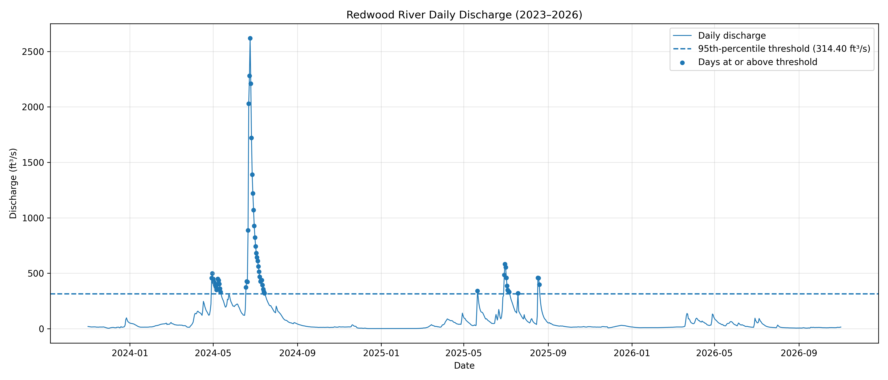

# River-Watch-Redwood-River-near-Marshall-MN
A data pipeline analyzing rainfall and streamflow in the Redwood River near Marshall, Minnesota.
# River Watch: Redwood River near Marshall, MN

## Project Question

How does the Redwood River respond to rainfall, and how often does it pass flood level?

## Study Area

- **River:** Redwood River
- **Location:** Near Marshall, Lyon County, Minnesota
- **USGS Monitoring Station:** 05315000
- **Coordinates:** 44.430156, -95.82945
- **Study Period:** November 1, 2023 – November 1, 2026

## Data Sources

- [USGS Water Data API](https://api.waterdata.usgs.gov/ogcapi/v1/collections/daily/items) – Daily mean stream discharge.
- [Open-Meteo Historical Weather API](https://archive-api.open-meteo.com/v1/archive) – Daily precipitation, snowfall, and temperature.

## Data Pipeline

Extract → Transform → Combine → Load → Analyze

1. Extract daily streamflow and weather data from public APIs.
2. Transform and clean the raw datasets.
3. Combine streamflow and weather records using the date.
4. Load cleaned data into CSV and SQLite.
5. Analyze rainfall and discharge relationships using Python and matplotlib.

## Key Findings

- The combined dataset contained **1,095 daily records**, with no missing values after joining.
- The 95th percentile discharge threshold was **314.4 ft³/s**.
- There were **42 flagged days in 2024** and **13 flagged days in 2025**.
- The longest consecutive period above the threshold was **28 days**.
- Rainfall and discharge had a correlation of approximately **0.182**, indicating a relatively weak linear relationship.

## Charts

Charts generated during the analysis:

- Daily discharge and flood threshold
- Rainfall and discharge during a storm event
- Rainfall and discharge relationship

## Limitations

- The 95th percentile is a statistical threshold, not necessarily an official flood stage.
- Rainfall measurements represent weather estimates at the gauge coordinates rather than direct measurements at every point in the watershed.
- Streamflow can be influenced by snowmelt, upstream conditions, soil saturation, and other factors beyond daily rainfall.
- The correlation between rainfall and discharge does not establish causation.

## Reproducibility

The project was developed using Python in Google Colab.

**[Open Notebook in Google Colab](https://colab.research.google.com/drive/1piDoBXQTnNL5GztM7KnkruL6qwE1Ysrm?usp=sharing)**

Libraries used include:
- requests
- pandas
- matplotlib
- sqlite3
- json
- datetime

## Attribution

Streamflow data provided by the U.S. Geological Survey (USGS).

Weather data provided by Open-Meteo.

## Author

[Don Huynh]
